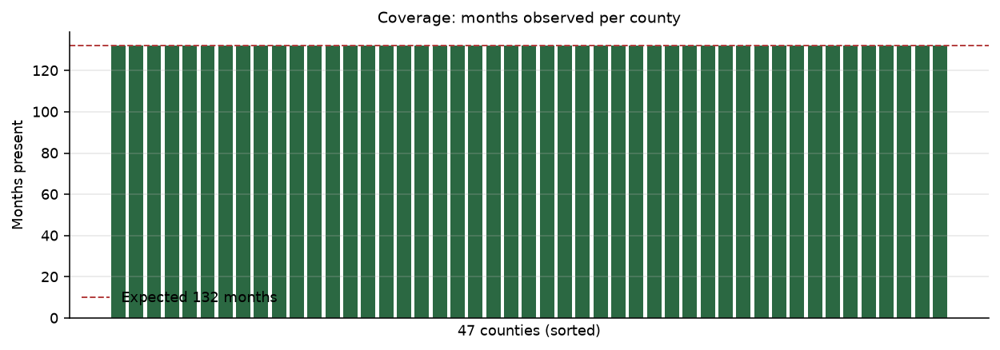

# Coverage: months observed per county

Each bar is one county; the dashed line is the 132 months in 2015-01 to 2025-12.

**Reading it:** all 47 bars reach the line, so the panel is balanced — 6,204 rows
= 47 x 132.

**Why it matters:** an unbalanced panel would break the lag and rolling-mean features in
`ml-models/notebooks/`, because a missing month silently shifts every subsequent lag. The
validation cell in `01_data_cleaning.ipynb` fails the build if a county is short.

**What it does not show:** that the *values* are complete or correct. Coverage is about
rows, not quality.
