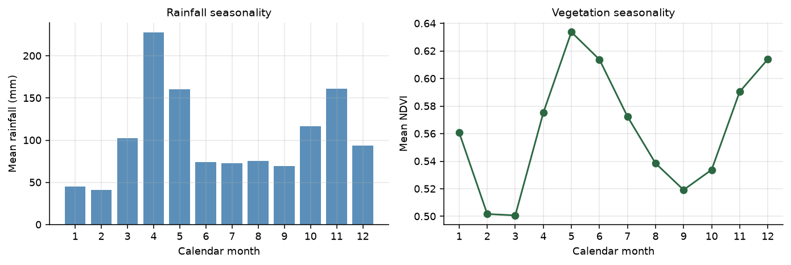

# Seasonality: rainfall and vegetation by month

Left: mean rainfall per calendar month across all counties and years. Right: mean NDVI.

**Reading it:** rainfall peaks in the long rains (March–May) and again in the short rains
(October–December), with a dry January–February. NDVI tracks it with a lag: greenness rises
*after* the rains, not with them. Peak rainfall month 4
vs peak greenness month 5.

**Why it matters:** this lag is the physical reason the model's NDVI-lag and rolling
features carry signal. It is also why same-month weather cannot be an early warning — the
rain that drives greenness arrives before the greenness does.

**What it does not show:** causation, or that the relationship is stable per county. The
next charts disaggregate.
