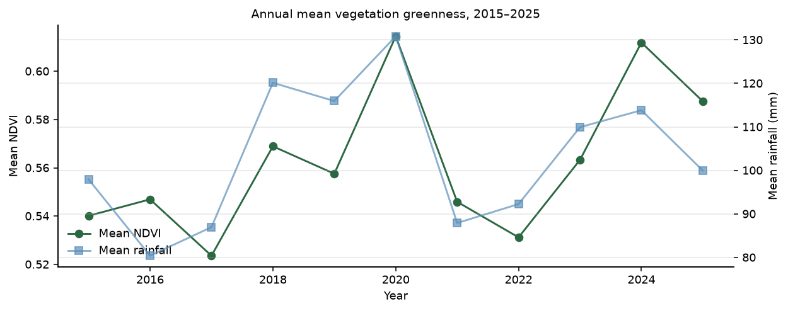

# Annual mean NDVI and rainfall, 2015–2025

Two axes: NDVI on the left, rainfall on the right. Both are unweighted means over counties.

**Reading it:** the NDVI range across eleven years is narrow
(0.524–0.614), so year-on-year greenness barely
moves at the national aggregate. The lowest year is 2017 and the
highest 2020.

**Why it matters:** a flat national mean means the interesting variation is *county-level
and seasonal*, not national-annual. Any model that only used a national time trend would
have almost nothing to learn from.

**What it does not show:** a trend over time in either direction. Eleven points cannot
support a trend claim, and the last years of such a series are typically still subject to
satellite-product revisions.
