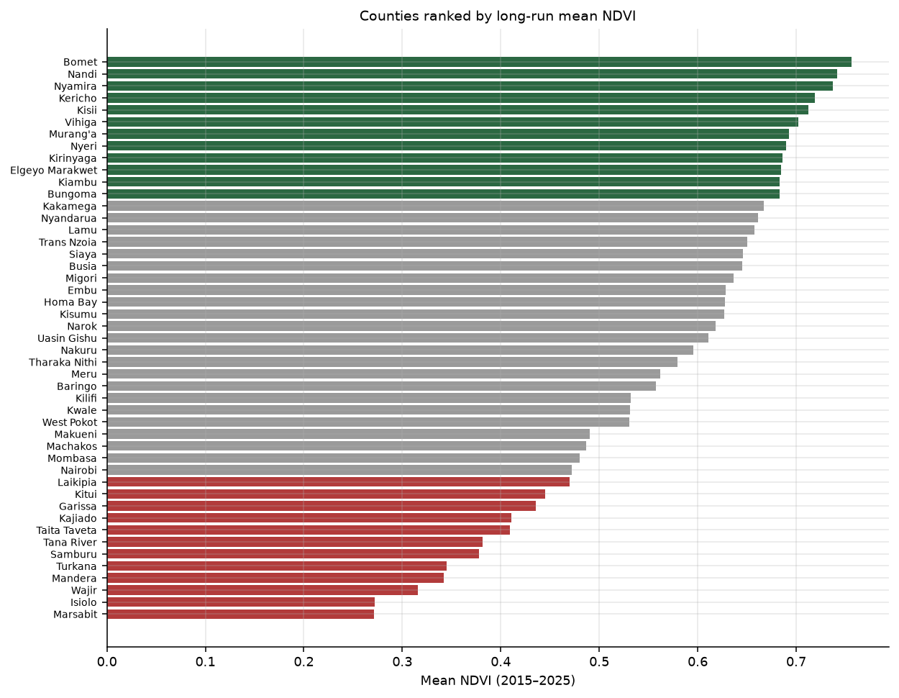

# Counties ranked by long-run mean NDVI

Bars are 11-year means per county. Red = bottom quartile, green = top quartile.

**Reading it:** the spread is wide — 0.271 (Marsabit) to
0.757 (Bomet). Arid northern counties (Turkana, Marsabit, Wajir,
Mandera, Garissa) sit at the bottom; highland and western counties at the top.

**Why it matters:** the model scores each county against *its own* historical distribution,
not a national threshold. A fixed national cut-off would label every northern county as
permanently at risk and never fire in the highlands. This chart is why the target is
county-relative.

**What it does not show:** that low NDVI means crop loss. Low average greenness is a
climate fact in the arid north, not an event.
