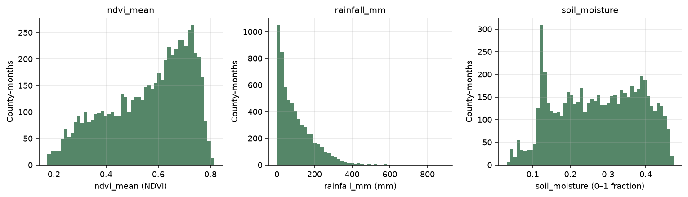

# Distributions of the core variables

Histograms of every county-month observation.

**Reading it:** NDVI is roughly bell-shaped around 0.56. Rainfall is
strongly right-skewed — most county-months are fairly dry, a tail runs to
887 mm. Soil moisture is left-skewed and clustered low.

**Why it matters:** the skew in rainfall is why the pipeline uses rainfall *anomalies* and
3-month totals rather than raw millimetres — a linear model on raw skewed rainfall would be
dominated by a handful of wet months.

**What it does not show:** whether outliers are errors. Extreme rainfall here is plausible
for Kenya; the checks in notebook 01 reject only physically impossible values.
