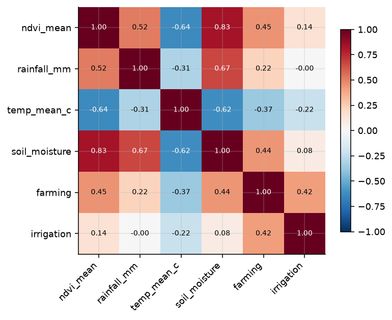

# Correlation matrix of core variables

Pearson correlation across all county-months.

**Reading it:** NDVI correlates with soil moisture (r = 0.83)
more than with same-month rainfall (r = 0.52). Temperature
correlates negatively (r = -0.64).

**Why it matters:** soil moisture integrates recent rainfall, so it is the better single
predictor — consistent with `forage_dryness_index` weighting both. The weak same-month
rainfall/NDVI link is the lag effect from chart 2, seen numerically.

**What it does not show:** causation, and it is computed across counties with very different
baselines, so much of the correlation is *between-county*, not within-county. A
within-county correlation would be lower.
