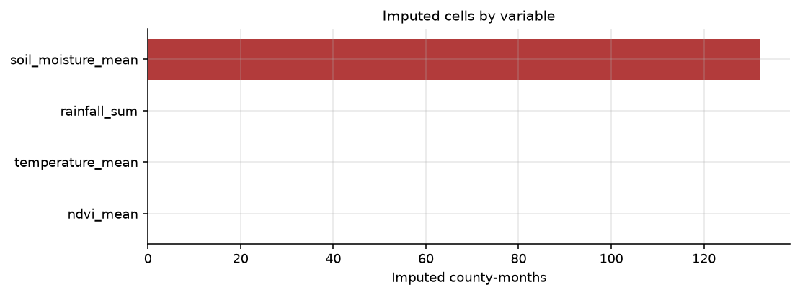

# Imputed cells by variable

Counts of cells filled by same-year-month national mean rather than observed.

**Reading it:** ndvi_mean: 0, temperature_mean: 0, rainfall_sum: 0, soil_moisture_mean: 132.

**Why it matters:** imputation is an assumption, not a measurement. These counts are
recorded so a reader can judge how much of any result rests on them. In this panel the
affected variable is soil moisture, consistent with `docs/DATA_MODEL_CARD.md`.

**What it does not show:** whether the imputed values are *good*. Filling from the same month
and year is defensible for a slowly-varying variable and indefensible for one that jumps.
