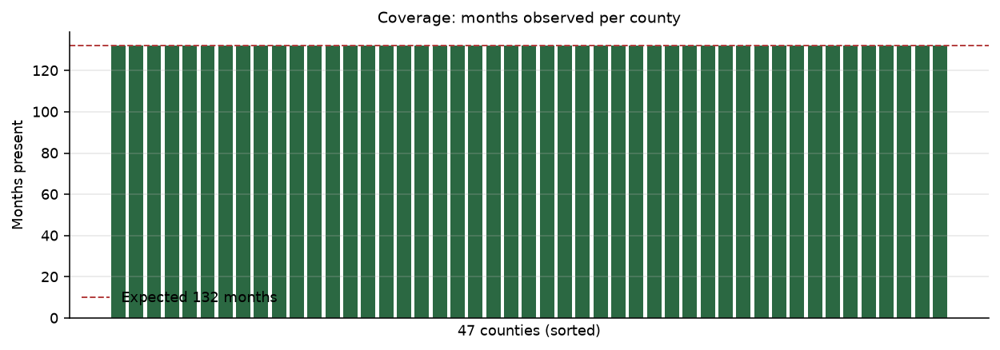
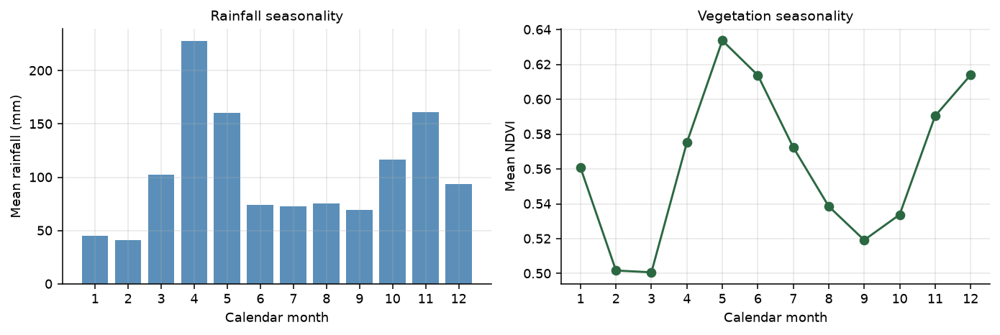
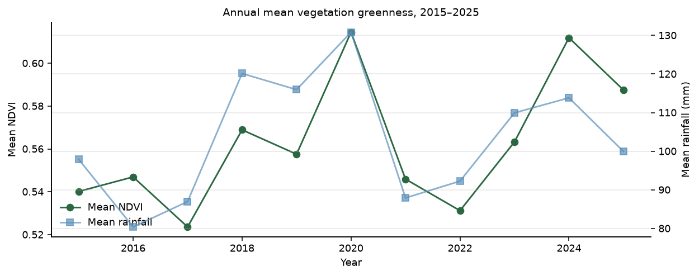
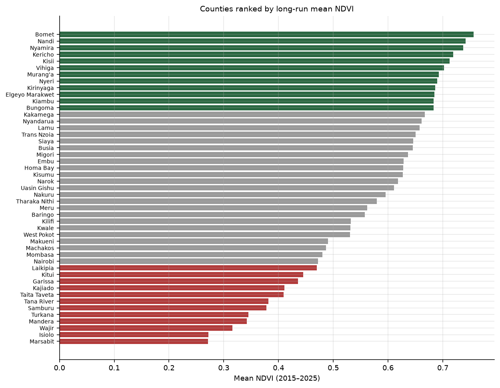
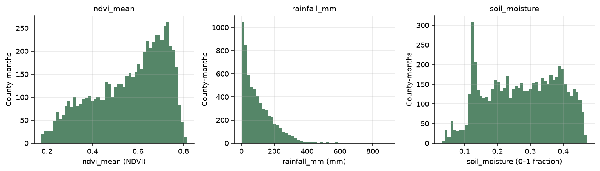
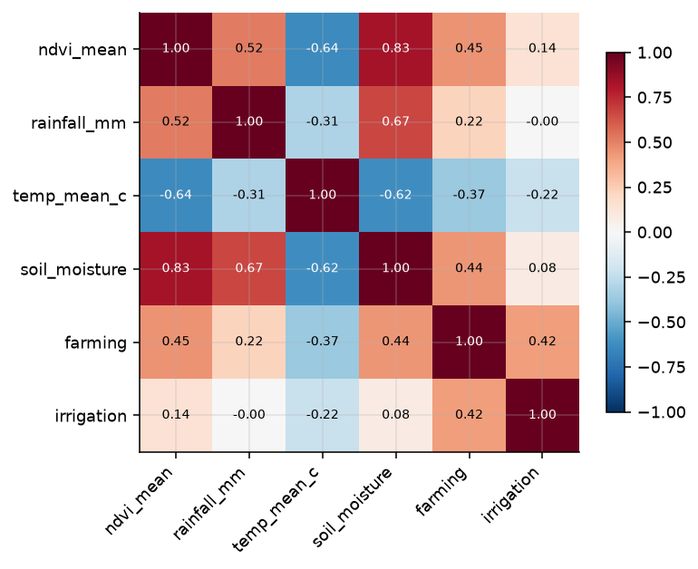
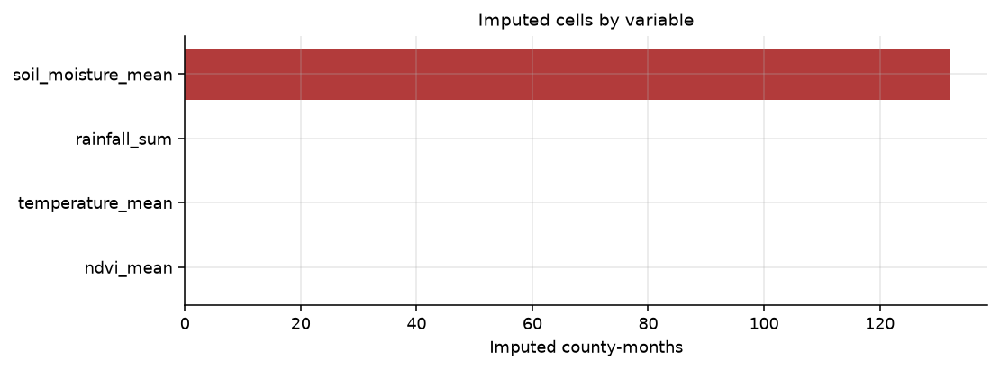

# Chart explanations — exploratory data analysis

Generated by `data_pipeline/notebooks/02_eda.ipynb`.
Panel: `master_cleaned_2015_2025.csv` — 6,204 county-months, 47 counties,
2015-01 to 2025-12.

**Read this first.** These charts describe a harmonised panel of satellite and reanalysis
data. They do not show crop loss, forage availability, or model accuracy. The ML target is
a synthesized "NDVI below the county's 25th percentile" label. See `docs/DATA_MODEL_CARD.md`.

---

# Coverage: months observed per county

Each bar is one county; the dashed line is the 132 months in 2015-01 to 2025-12.

**Reading it:** all 47 bars reach the line, so the panel is balanced — 6,204 rows
= 47 x 132.

**Why it matters:** an unbalanced panel would break the lag and rolling-mean features in
`ml-models/notebooks/`, because a missing month silently shifts every subsequent lag. The
validation cell in `01_data_cleaning.ipynb` fails the build if a county is short.

**What it does not show:** that the *values* are complete or correct. Coverage is about
rows, not quality.

---

# Seasonality: rainfall and vegetation by month

Left: mean rainfall per calendar month across all counties and years. Right: mean NDVI.

**Reading it:** rainfall peaks in the long rains (March–May) and again in the short rains
(October–December), with a dry January–February. NDVI tracks it with a lag: greenness rises
*after* the rains, not with them. Peak rainfall month 4
vs peak greenness month 5.

**Why it matters:** this lag is the physical reason the model's NDVI-lag and rolling
features carry signal. It is also why same-month weather cannot be an early warning — the
rain that drives greenness arrives before the greenness does.

**What it does not show:** causation, or that the relationship is stable per county. The
next charts disaggregate.

---

# Annual mean NDVI and rainfall, 2015–2025

Two axes: NDVI on the left, rainfall on the right. Both are unweighted means over counties.

**Reading it:** the NDVI range across eleven years is narrow
(0.524–0.614), so year-on-year greenness barely
moves at the national aggregate. The lowest year is 2017 and the
highest 2020.

**Why it matters:** a flat national mean means the interesting variation is *county-level
and seasonal*, not national-annual. Any model that only used a national time trend would
have almost nothing to learn from.

**What it does not show:** a trend over time in either direction. Eleven points cannot
support a trend claim, and the last years of such a series are typically still subject to
satellite-product revisions.

---

# Counties ranked by long-run mean NDVI

Bars are 11-year means per county. Red = bottom quartile, green = top quartile.

**Reading it:** the spread is wide — 0.271 (Marsabit) to
0.757 (Bomet). Arid northern counties (Turkana, Marsabit, Wajir,
Mandera, Garissa) sit at the bottom; highland and western counties at the top.

**Why it matters:** the model scores each county against *its own* historical distribution,
not a national threshold. A fixed national cut-off would label every northern county as
permanently at risk and never fire in the highlands. This chart is why the target is
county-relative.

**What it does not show:** that low NDVI means crop loss. Low average greenness is a
climate fact in the arid north, not an event.

---

# Distributions of the core variables

Histograms of every county-month observation.

**Reading it:** NDVI is roughly bell-shaped around 0.56. Rainfall is
strongly right-skewed — most county-months are fairly dry, a tail runs to
887 mm. Soil moisture is left-skewed and clustered low.

**Why it matters:** the skew in rainfall is why the pipeline uses rainfall *anomalies* and
3-month totals rather than raw millimetres — a linear model on raw skewed rainfall would be
dominated by a handful of wet months.

**What it does not show:** whether outliers are errors. Extreme rainfall here is plausible
for Kenya; the checks in notebook 01 reject only physically impossible values.

---

# Correlation matrix of core variables

Pearson correlation across all county-months.

**Reading it:** NDVI correlates with soil moisture (r = 0.83)
more than with same-month rainfall (r = 0.52). Temperature
correlates negatively (r = -0.64).

**Why it matters:** soil moisture integrates recent rainfall, so it is the better single
predictor — consistent with `forage_dryness_index` weighting both. The weak same-month
rainfall/NDVI link is the lag effect from chart 2, seen numerically.

**What it does not show:** causation, and it is computed across counties with very different
baselines, so much of the correlation is *between-county*, not within-county. A
within-county correlation would be lower.

---

# Imputed cells by variable

Counts of cells filled by same-year-month national mean rather than observed.

**Reading it:** ndvi_mean: 0, temperature_mean: 0, rainfall_sum: 0, soil_moisture_mean: 132.

**Why it matters:** imputation is an assumption, not a measurement. These counts are
recorded so a reader can judge how much of any result rests on them. In this panel the
affected variable is soil moisture, consistent with `docs/DATA_MODEL_CARD.md`.

**What it does not show:** whether the imputed values are *good*. Filling from the same month
and year is defensible for a slowly-varying variable and indefensible for one that jumps.
