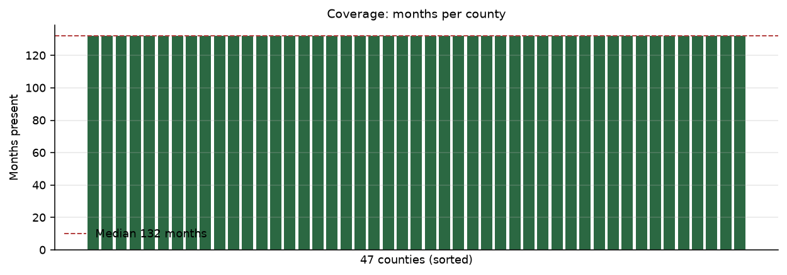

# Coverage: months per county

Each bar is one county; dashed line is the median (132 months). All 47 bars reach it, so the panel is balanced: 6,204 rows = 47 x 132. If a bar was short, lags in the ML code would be wrong.
