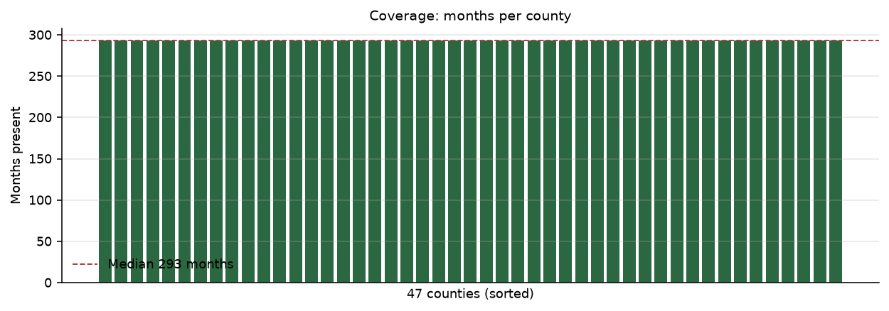
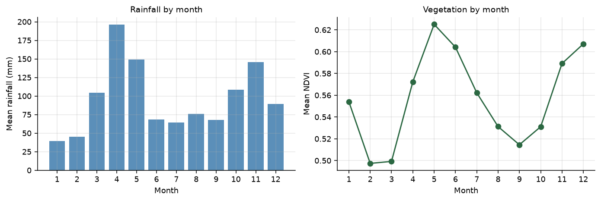
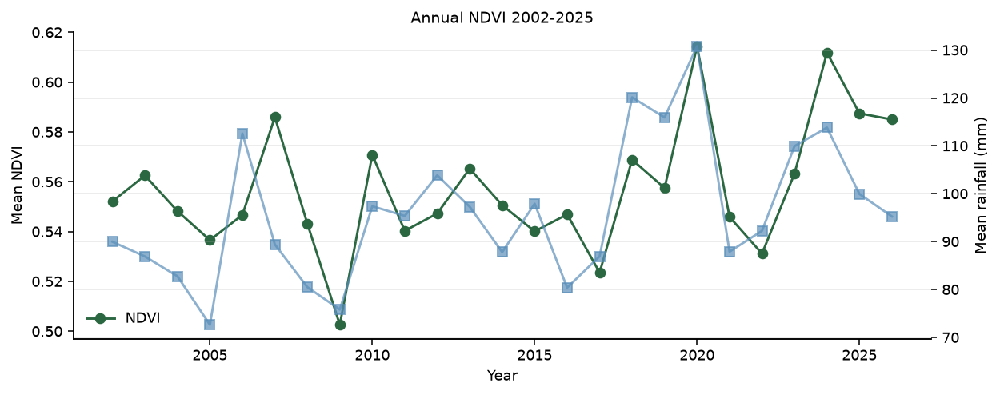
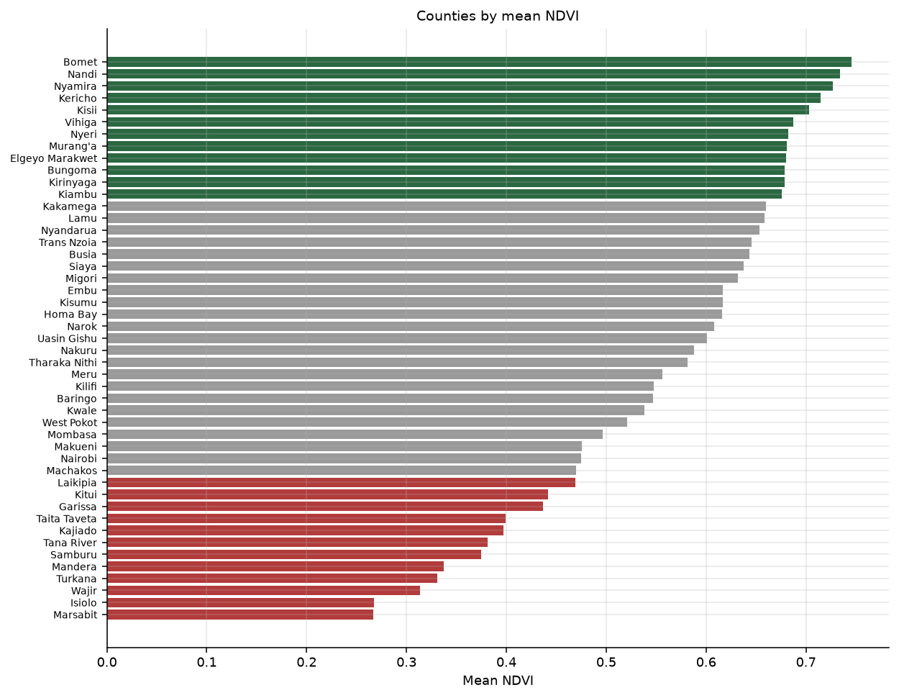
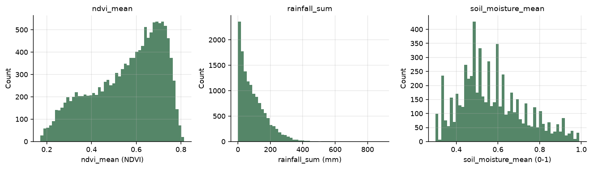
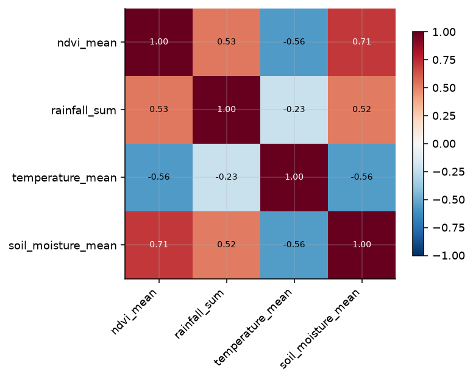

# EDA - 13,771 rows, 47 counties, 2002-07 to 2026-11
Panel: master_cleaned_2015_2025.csv - 13,771 rows.
These are descriptive stats only. ML target is synthesized low-NDVI.
---
# Coverage: months per county

Each bar is one county; dashed line is the median (293 months). All 47 bars reach it, so the panel is balanced: 13,771 rows = 47 x 293. If a bar was short, lags in the ML code would be wrong.

---

# Rainfall and NDVI by month

Rain peaks in long rains (Mar-May) and short rains (Oct-Dec). NDVI follows with a lag. Peak rain month 4, peak NDVI month 5.

---

# Annual NDVI and rainfall

NDVI range 0.503 to 0.614. National mean is flat; most change is at county level, not national.

---

# Counties ranked by NDVI

Spread 0.266 (Marsabit) to 0.746 (Bomet). Arid north (Turkana, Marsabit) low, highlands high. Model uses county-relative threshold.

---

# Distributions

NDVI avg 0.56. Rainfall is right-skewed (tail to 887 mm).

---

# Correlation matrix

NDVI vs soil r=0.71, vs rain r=0.53. Soil has many NaNs early, so soil correlation is weak.
