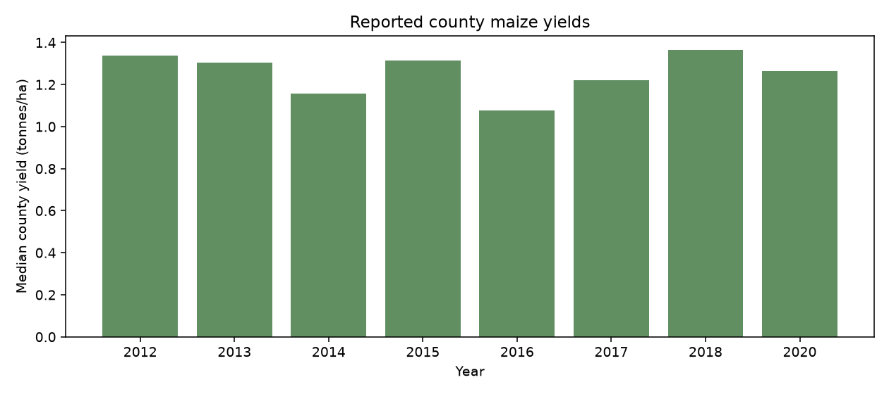

# Reported maize outcome exploration

The mirrored workbook contains 376 county-year rows for 47 counties across 2012–2018 and 2020; 2019 is missing. 373 rows pass the basic area and consistency checks; 3 are flagged, not corrected.

The chart gives each county equal weight and is not a national production-weighted yield. The reported yield is a historical crop outcome, not a loss or real-time risk. Source and redistribution rights require independent verification.

