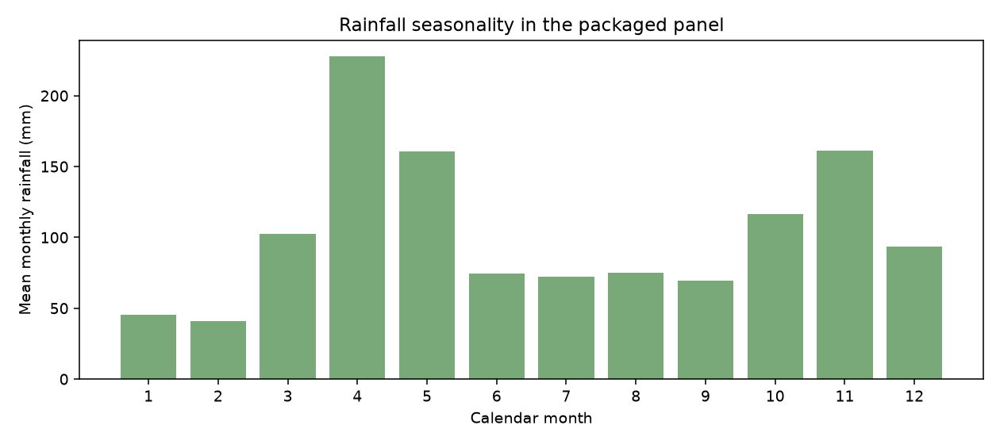
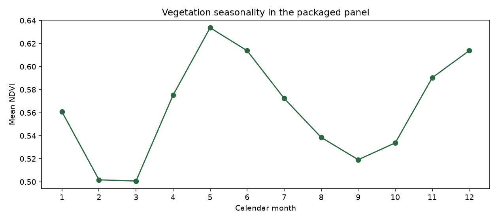

# Packaged panel: exploratory analysis

- Rows: 6,204; counties: 47; period: 2015-01 to 2025-12.
- Cleaned panel SHA-256: `ebc17397bb70b1598734933cb4df5c53b58342b341c856ed592f3d8ec89b3185`.
- Explicit same-year/month national mean imputation counts: {'ndvi_mean_imputed': 0, 'temperature_mean_imputed': 0, 'rainfall_sum_imputed': 0, 'soil_moisture_mean_imputed': 132}.
- Missing climate values after imputation: 0.
- Lowest and highest unweighted annual mean NDVI: 2017 (0.524) and 2020 (0.614).

Both charts are unweighted means of the checked-in county-month panel. They describe that dataset, not measured crop losses or forage availability. Source acquisition and licenses have not been independently verified; imputed soil values are not measurements. This descriptive analysis cannot establish causes or forecast performance.
